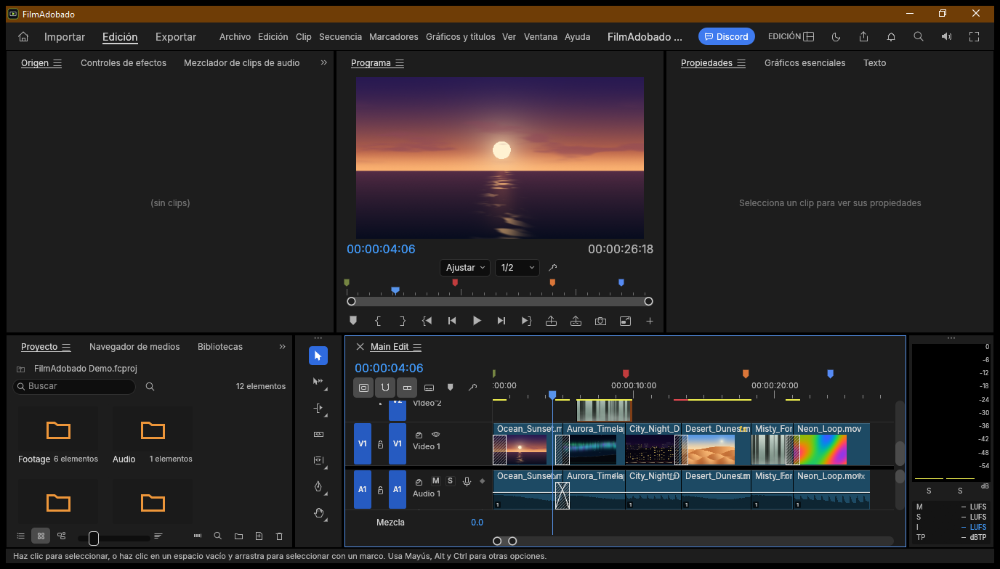

# FilmAdobado

**Edita tus proyectos de vídeo.**

> **Pruebas en Windows (20/10/2026):** la compilación, la instalación y el inicio se han comprobado. Aún falta probar un flujo completo con un archivo real: abrirlo, editarlo y exportarlo.
>
> Proyecto independiente. No afiliado a ArtCraft ni a Adobe.

Captura real de la aplicación en Windows.

## Estado

- **Build de Windows:** correcto en GitHub Actions; consulta el [workflow actual](https://github.com/smouj/FilmAdobado/actions/workflows/windows-build.yml).
- **Instalación e inicio:** comprobados en Windows el 20/10/2026.
- **Prueba con un archivo:** aún falta completar el flujo de abrir, editar y exportar.
- **Estado:** alpha; aún falta validar un flujo completo con un archivo real.
- **Descarga pública:** [v0.1.0-alpha.1](https://github.com/smouj/FilmAdobado/releases/tag/v0.1.0-alpha.1) es una versión alpha y conserva el icono anterior. El flujo con archivos reales aún no está validado; tenlo en cuenta antes de descargarla.
- **Commit de origen:** fb4cbda47a134eedabd89fe02cd59ebc69462737.

## Build

Requisitos: Rust 1.95 o superior.

    cargo build --release -p filmcraft

El nombre interno del crate se conserva para no romper el workspace; el nombre de producto visible es FilmAdobado.

## Procedencia y licencias

- Upstream: https://github.com/storytold/filmcraft
- Commit base: fb4cbda47a134eedabd89fe02cd59ebc69462737
- Licencia: MIT OR Apache-2.0. Se conservan los archivos de licencia, NOTICE y ATTRIBUTION del upstream.
- Cambios: docs/ADOBADO.md.
- La marca, el wordmark y los logos de ArtCraft no estan cubiertos por la licencia y se retiran de la distribucion.

## Adobado Kit

Este repo forma parte de Adobado Kit: https://github.com/smouj/Adobado_Kit

Hecho por @smouj.
